# MoMo Fraud & Intrusion Detection: User Manual

Last updated: 29 October 2026

## Contents

1. [Introduction](#1-introduction)
2. [Getting started](#2-getting-started)
3. [Creating an account, signing in and signing out](#3-creating-an-account-signing-in-and-signing-out)
4. [A tour of the dashboard](#4-a-tour-of-the-dashboard)
5. [Overview](#5-overview)
6. [Analyse data](#6-analyse-data)
7. [Live monitor](#7-live-monitor)
8. [Check a transaction](#8-check-a-transaction)
9. [Model results](#9-model-results)
10. [Account page](#10-account-page)
11. [Using the API with your API key](#11-using-the-api-with-your-api-key)
12. [Reading the results](#12-reading-the-results)
13. [Security and privacy](#13-security-and-privacy)
14. [Running it for others](#14-running-it-for-others)
15. [Troubleshooting and FAQ](#15-troubleshooting-and-faq)
16. [Glossary](#16-glossary)

## 1. Introduction

MoMo Fraud & Intrusion Detection is a web platform that scores mobile money transactions for fraud and
account-takeover risk, explains each alert in plain language, and recommends what to do next. You use it
from a browser after signing in with your own account.

It was built for the Ghanaian mobile money context. It looks at the transaction itself (type, amount,
balances) together with access signals (which devices an account uses, whether its SIM was recently changed)
to catch three attack patterns that money-only checks miss: **SIM-swap takeover**, **PIN-sharing abuse** and
**agent collusion**.

**Who it is for**

- Fraud and security analysts at banks, telcos and mobile money operators who want to screen a batch of
  transactions or watch a live feed.
- Researchers, lecturers and students who want to test the model on their own data.
- Engineers who want to connect a payment system to it through the API.

**What you can do with it**

| Task | Where |
| --- | --- |
| See the project's headline results and attack patterns | Overview |
| Score a file, database table or API feed and get findings in plain language | Analyse data |
| Watch transactions being scored as they arrive | Live monitor |
| Score one transaction you type in by hand | Check a transaction |
| Compare the trained models and see what drives them | Model results |
| Manage your profile, password, API key and see your security activity | Account |

**How it works.** Whichever way data arrives (file upload, database, REST API or live ingest), the
*feature builder* matches its column names and builds the model's 21 inputs, including device and SIM
signals. The *XGBoost model* gives every transaction a risk score from 0% to 100% in milliseconds. The
*interpretation* layer turns scores into response tiers, findings with evidence and per-transaction reasons.
Results are private to your account.

The model was trained on 6.36 million PaySim transactions enriched with simulated device and SIM events. On
a held-out test set of 1.27 million transactions it caught 99.6% of attacks (recall), with an AUC-PR of 0.94.
See [MODEL_CARD.md](../MODEL_CARD.md) for its limits.

## 2. Getting started

If someone already runs the platform on a server, skip this section: open the address they gave you and go
to section 3. To run it on your own computer you need Python 3.11 to 3.13 (3.12 recommended) and about 1 GB
of free disk space. You do not need Node.js or the training dataset.

**Get the code**

```bash
git clone https://github.com/OforiPrescott/momo-fraud-detection-week7.git
cd momo-fraud-detection-week7
```

Already have a copy? Run `git pull` inside the folder to update it.

**Windows**

1. Install Python 3.12 from [python.org/downloads](https://www.python.org/downloads/). Tick **Add python.exe
   to PATH** during setup.
2. Double-click `start.bat` in the project folder.
3. The first run creates a virtual environment and installs the packages (a few minutes). Your browser then
   opens at http://localhost:8000.

**macOS (Intel or Apple Silicon)**

1. Install [Homebrew](https://brew.sh) if you do not have it.
2. Install Python 3.12: `brew install python@3.12`, or the "macOS 64-bit universal2" installer from
   [python.org](https://www.python.org/downloads/macos/). The `python3` that ships with macOS is usually too old.
3. In Terminal, inside the project folder, run `./start.sh`.
4. The script installs the packages and `libomp` (a library the model needs on macOS), starts the server and
   opens http://localhost:8000.

**Linux**

1. Install Python 3.12 and venv, for example `sudo apt install python3.12 python3.12-venv`.
2. Run `./start.sh` in the project folder.

**Docker (any OS, no Python needed)**

With Docker Desktop running, run `docker compose up --build` in the project folder, then open
http://localhost:8000. Accounts are kept in a Docker volume, so they survive rebuilds.

**Starting it again later.** Run `start.bat` or `./start.sh` again; later starts take a few seconds. Press
**Ctrl+C** in the terminal window to stop the server. To use another port: `PORT=8080 ./start.sh` (macOS,
Linux) or `set PORT=8080` then `start.bat` (Windows).

## 3. Creating an account, signing in and signing out

Everyone needs their own account; there is no shared or default login. Accounts are stored on the server
you use, so an account made on one computer does not exist on another.

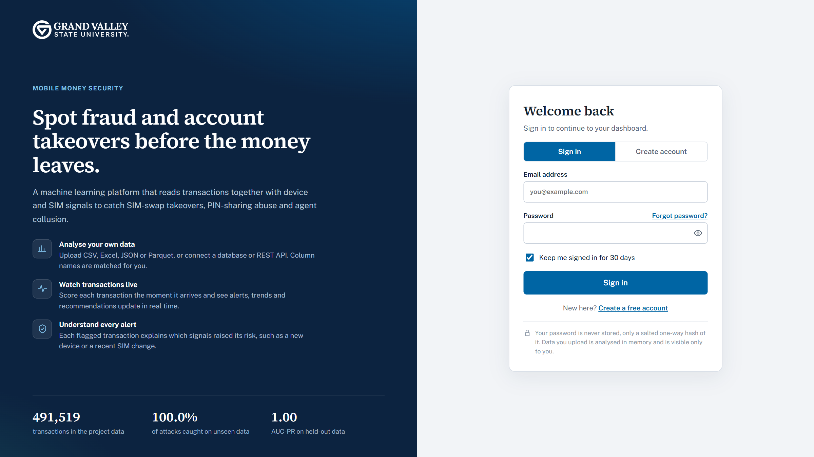

**Create an account**

1. Open the platform's address, for example http://localhost:8000.
2. Click **Create account**.
3. Enter your full name, your organisation (optional) and your email address.
4. Choose a password. The rules:
    - at least 8 characters, with at least one letter and one number;
    - not one of the most common passwords (such as `password123` or `qwerty123`);
    - must not contain your name or the first part of your email address;
    - must not be made of only a few repeated characters (such as `aaaaaaa1`).
   The meter under the field shows its strength; aim for Good or Strong. A long phrase of several words with
   a number is easy to remember and hard to guess.
5. Type the password again in **Confirm password** and click **Create account**.

You are signed in straight away and land on the Overview page.

**Sign in**

1. Enter your email and password. Email is not case-sensitive.
2. Leave **Keep me signed in for 30 days** ticked on your own computer. Untick it on a shared computer; you
   are then signed out after 24 hours.
3. Click **Sign in**.

The eye icon in a password field shows or hides what you typed.

**Sign out**

- On a computer: click the arrow next to your name at the bottom of the sidebar.
- On a phone: tap the person icon in the top menu, then **Sign out**.
- To end every session at once, use **Sign out of all devices** on the Account page.

**If sign-in fails**

- "Email or password is incorrect" means one of the two is wrong. The platform does not say which, so
  attackers cannot find out which emails have accounts.
- After 8 failed attempts in 15 minutes, sign-in is paused. Wait 15 minutes and try again.
- "Please sign in to continue" during use means your session ended. Sign in again.
- "This request came from another website and was blocked" means a page on another site tried to act on
  your account. Open the platform directly from its own address.

**Forgot your password?**

1. On the sign-in page, click **Forgot password?** (beside the Password label).
2. Enter your email address and click **Send reset link**. You see the same message whether or not the email
   has an account, so nobody can use this page to find out who is registered.
3. Open the email and click the link within **30 minutes**. It works **once**.
4. Choose a new password (the same rules apply), type it twice and click **Set new password**.
5. Every device is signed out. Sign in with your new password and, if it is on, your authenticator code.

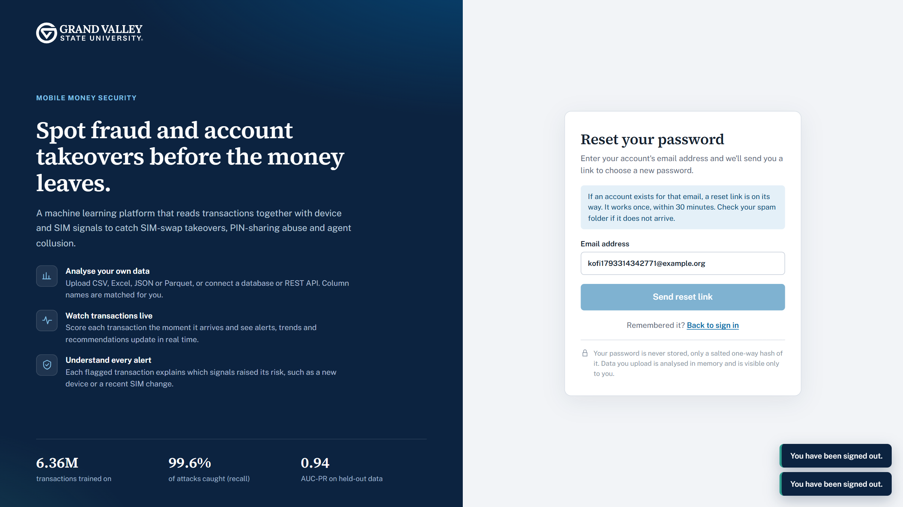

No email? Check your spam folder, then ask for a new link (at most 5 requests per 15 minutes). On a computer
running the platform without an email server ("console mode"), the link appears in the server's terminal
window instead: the person running the server can copy it to you.

**Signing in with two-step sign-in.** If you have turned it on (section 10), after your password the page asks
for the **6-digit code** your authenticator app shows for MoMo Fraud Detection. Codes change every 30
seconds; type the current one. Lost your phone? Click **Lost your phone? Use a recovery code** and enter one
of the recovery codes you saved. Each recovery code works once.

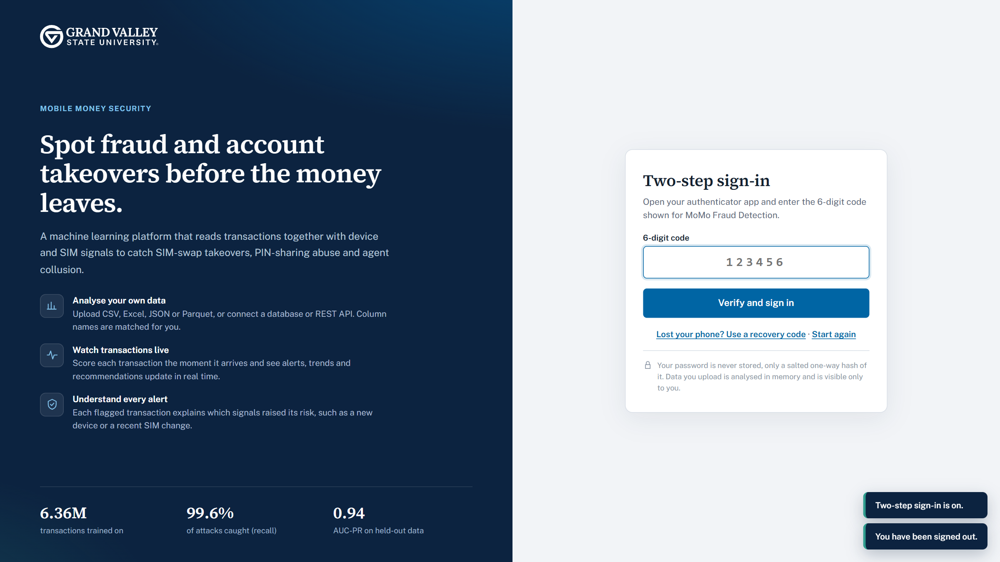

## 4. A tour of the dashboard

After you sign in, the dark sidebar on the left is your main menu; on a phone it becomes a row of icons.

| Sidebar item | What it holds |
| --- | --- |
| **Overview** | Project summary, attack-pattern counts and key insights |
| **Analyse data** | Bring in your own data and get a full analysis |
| **Live monitor** | Real-time scoring, replay and the ingest endpoint |
| **Check a transaction** | Score a single transaction you type in |
| **Model results** | How the trained models compare and what drives them |
| **Account** (phone menu, or click your name) | Profile, password, API key, security activity, sign out |

At the bottom of the sidebar:

- **Currency label** chooses the symbol shown before amounts (GHS, $, ₦, KSh and others). It only changes
  the label; amounts are never converted.
- **API status**: a green dot and "API connected" mean everything works; a red dot means the dashboard cannot
  reach the server (see Troubleshooting).
- **Your name and organisation**: click it to open the Account page; click the arrow beside it to sign out.

A green dot beside **Live monitor** means a replay is running in the background. Every page can be printed or
saved as a PDF with your browser's print command (Ctrl+P, or Cmd+P on a Mac).

## 5. Overview

The Overview page summarises the project's own data and results; it does not change with your uploads.

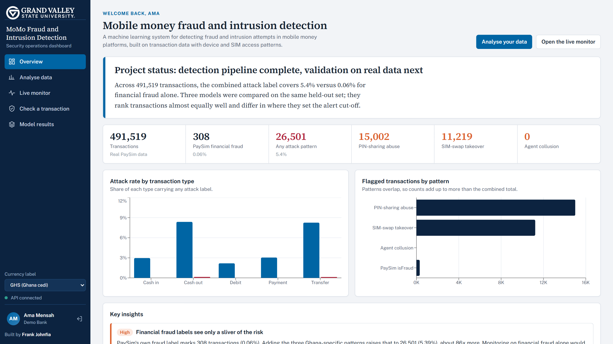

1. **Briefing**: a short plain-language status of the project.
2. **Counters**: total transactions, PaySim financial fraud, transactions with any attack pattern, and each
   of the three Ghana-specific patterns.
3. **Attack rate by transaction type**: Cash out and Transfer are the riskiest.
4. **Flagged transactions by pattern**: patterns overlap, so the bars add up to more than the total.
5. **Key insights**: findings with their supporting numbers.

**Analyse your data** and **Open the live monitor** at the top take you to the main tasks.

## 6. Analyse data

Analyse data scores every transaction in a dataset, flags the risky ones and explains what it found. Start
with the **Project sample** to see every feature, then bring your own data.

### 6.1 Choose where the data comes from

| Tab | Use it when | What to enter |
| --- | --- | --- |
| **Upload a file** | You have an export on your computer | Drop a file on the box or click **Choose a file** |
| **Connect a database** | The data sits in PostgreSQL or MySQL/MariaDB | Host, port, user, password, database, and a table name or one SELECT query, then **Connect and analyse** |
| **Pull from an API** | Another system serves transactions over HTTP | Endpoint URL, method, optional headers and body, where the records sit in the JSON, then **Fetch and analyse** |
| **Project sample** | You want a demo with known answers | **Analyse the project sample** (5,000 labelled transactions) |

**File formats:** CSV, TSV, TXT, Excel (.xlsx, .xlsm, .xls), JSON, JSON Lines, Parquet, and compressed
.csv.gz, .csv.zip or .json.gz (one file per zip). Limits: 300 MB per file, 1,000,000 rows, and a compressed
file may expand to at most four times the upload limit.

**Columns.** Only an amount and a transaction type are required. Names are matched flexibly: `amount`,
`amt` or `value`; `type` or `transaction_type`. The more of these you include, the better the scores:

- sender and receiver account IDs (`nameOrig`, `nameDest` or similar);
- balances before and after, for sender and receiver;
- a time step or timestamp;
- a device ID and a SIM-change flag: the strongest signals;
- a confirmed-fraud column (for example `isFraud`, 1 or 0), so the platform can measure its own accuracy.

No device column? Add an **access-events file** (device and SIM-change log) with the optional second upload.

**Your data is cleaned and every correction is reported**: rows with a non-numeric amount are skipped,
negative amounts (refunds, reversals) are scored by their size, and impossible values (infinite or too large)
are set to zero. Look for these notes on the Data quality tab.

**Databases** are opened read-only; only a single SELECT is accepted, and credentials are used for that one
request and never stored. The SQLite option reads a file on the server itself and is switched off on shared
servers.

### 6.2 Read the result

The result appears within seconds, organised under the alert threshold and four tabs.

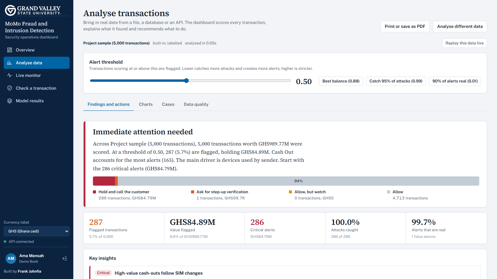

1. **Alert threshold** (above the tabs): the score at which a transaction is flagged. Lower catches more
   attacks and creates more alerts; higher is stricter. With a fraud column, three quick buttons set it for
   you: **Best balance**, **Catch 95% of attacks** and **90% of alerts real**. Every tab updates as you move it.
2. **Findings and actions**: a headline, a paragraph explaining what was found, a coloured ribbon splitting
   every transaction into four response tiers (section 12), counters, the **Key insights** with severity tags
   and evidence, and **What these numbers mean**.
3. **Charts**: share flagged by type and by hour, how risk scores are spread, what drives the alerts and,
   when rule columns exist, rule-based detection versus the model.
4. **Cases**: senders flagged more than once, receivers collecting flagged payments, and the full flagged
   transactions table.
5. **Data quality**: how much of the model's signal your data provided, how similar your data is to the
   training data, and where each model input came from.

**What these numbers mean.** Under the key insights, every figure is restated as a plain sentence using your
own results: what the risk score is, how many transactions the threshold flags, how much money is at risk,
which alerts to handle first, and, with a fraud column, how many attacks were caught or missed and how many
alerts were false alarms. Start here if you are not used to fraud metrics.

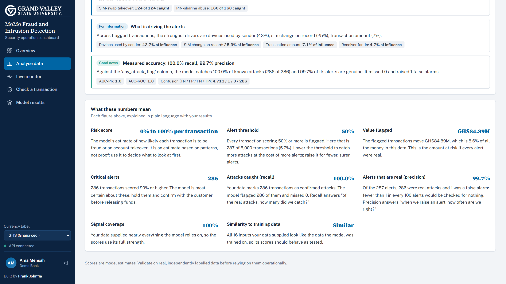

### 6.3 Work the flagged transactions

The **Flagged transactions** table on the **Cases** tab lists everything at or above the threshold.

- Filter by type, search for a sender or receiver, and click a column heading to sort.
- Click a row to open the case panel: the risk score, the recommended action, **Why the model scored it this
  way** (each factor that raised or lowered the score), other flagged transactions from the same sender or
  receiver, and the model inputs.
- **Download flagged (CSV)** exports the list for your case-management system. Account names that look like
  spreadsheet formulas are made safe so Excel cannot run them.

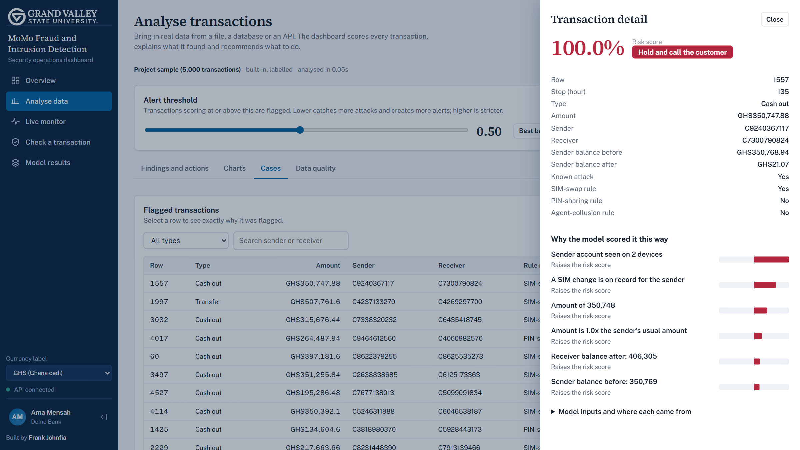

### 6.4 Next steps from a result

- **Replay this data live** sends the dataset to the Live monitor as if it were arriving in real time.
- **Print or save as PDF** produces a report of the analysis.
- **Analyse different data** clears the result so you can start again.

Your three most recent analyses are kept in memory for drill-down. They are lost when the server restarts,
so download anything you need to keep.

## 7. Live monitor

The Live monitor scores each transaction the moment it arrives. Your live monitor is yours alone.

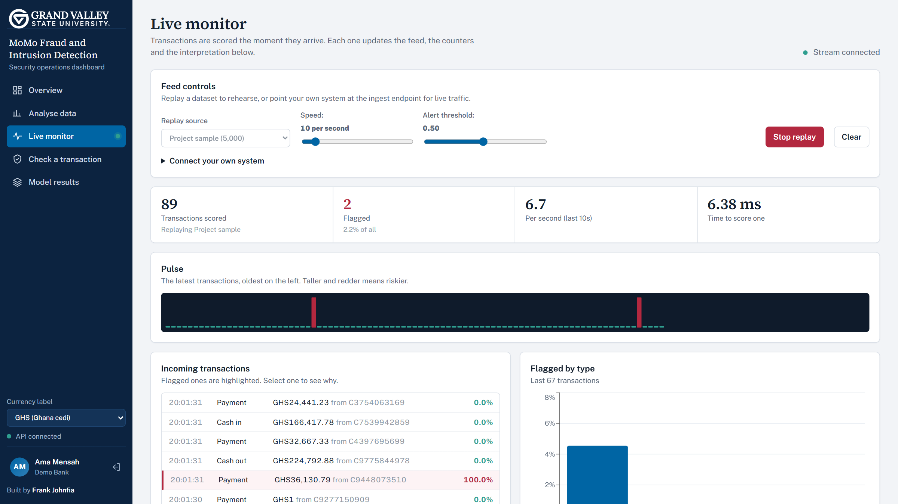

**Rehearse with a replay**

1. Under **Feed controls**, choose a **Replay source**: the project sample, or the dataset you last analysed.
2. Set **Speed** (1 to 100 transactions per second) and the **Alert threshold**.
3. Click **Start replay**. **Stop replay** pauses; **Clear** empties the feed and counters.

**What you see**

- **Counters**: transactions scored, flagged, rate per second, and time to score one (a few milliseconds).
- **Pulse**: one bar per recent transaction, oldest on the left; taller and redder means riskier.
- **Incoming transactions**: the latest 60; flagged ones are red; click one to see why.
- **Flagged by type**, then a **briefing and key insights** that appear after 20 transactions and refresh
  every few seconds.

"Stream connected" at the top right means the live link works; if it says "disconnected, retrying", the page
reconnects on its own.

**Connect your own system**: see section 11.

## 8. Check a transaction

Check a transaction scores one transaction you type in and shows the reasons behind the score.

1. Choose the **Type** and enter the **Amount**.
2. Fill in what you know: balances, hour of day, the sender's earlier transactions and usual amount, devices
   used by the sender, different senders paying the receiver, and whether a SIM change is on record.
3. Read the **Result**: risk score, recommended action and the factors that pushed it up or down.

Change one value at a time to see how the score responds. For example, a large cash-out that empties the
account scores far higher from a second device right after a SIM change.

## 9. Model results

| Model | Precision | Recall | F1 | AUC-PR |
| --- | --- | --- | --- | --- |
| XGBoost baseline | 0.494 | 0.993 | 0.660 | 0.943 |
| XGBoost tuned (used by the dashboard) | 0.487 | 0.996 | 0.654 | 0.942 |
| MLP neural network | 0.981 | 0.756 | 0.854 | 0.937 |

The page also shows **what drives the model** (devices used by the sender, about 78%), the **workload** each
model would create, and the **hyperparameter search**. The trade-off: XGBoost catches nearly every attack but
about half its alerts are false alarms; the neural network's alerts are almost always real but it misses a
quarter of attacks. The alert threshold lets you move along that trade-off.

## 10. Account page

Open it by clicking your name at the bottom of the sidebar, or the person icon on a phone.

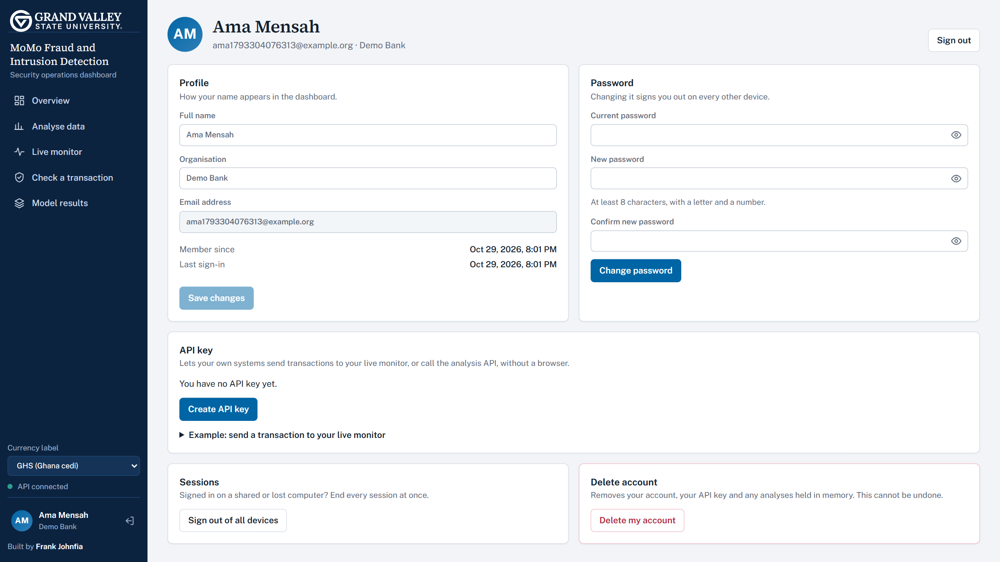

| Card | What you can do |
| --- | --- |
| **Profile** | Change your name and organisation. Shows when you joined and last signed in. |
| **Password** | Enter your current password and a new one twice. Every other device is signed out. |
| **API key** | **Create API key**, **Replace key** or **Revoke key** (section 11). Only from a signed-in browser. |
| **Two-step sign-in** | Turn on a second sign-in step with an authenticator app, create new recovery codes, or turn it off. |
| **Recent security activity** | Every sign-in, failed sign-in, password change, API key change and sign-out in the last 90 days, with time, device and network address. Failed attempts are highlighted. |
| **Sessions** | **Sign out of all devices** ends every session, including this one. |
| **Delete account** | Enter your password, then **Permanently delete**. Cannot be undone. |

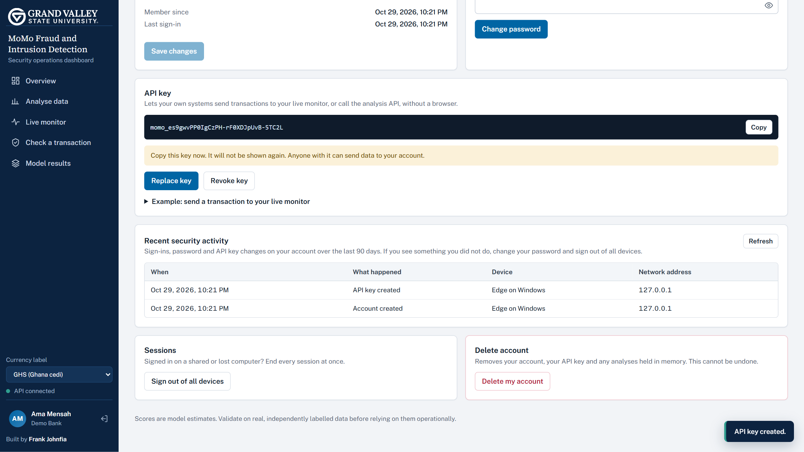

### Turning on two-step sign-in (recommended)

With two-step sign-in, someone who steals or guesses your password still cannot get in without your phone.

1. Install an authenticator app on your phone: Google Authenticator, Microsoft Authenticator, Authy or similar.
2. On the Account page, under **Two-step sign-in**, click **Turn on two-step sign-in** and confirm your password.
3. In the app, add an account and **scan the QR code**. If you cannot scan, choose "enter a setup key" and type
   the key shown beside it.
4. Type the 6-digit code the app now shows and click **Turn on**.
5. **Save the 8 recovery codes** that appear (Download or Copy), somewhere other than your phone, then click
   **I have saved them**. They are shown only once.

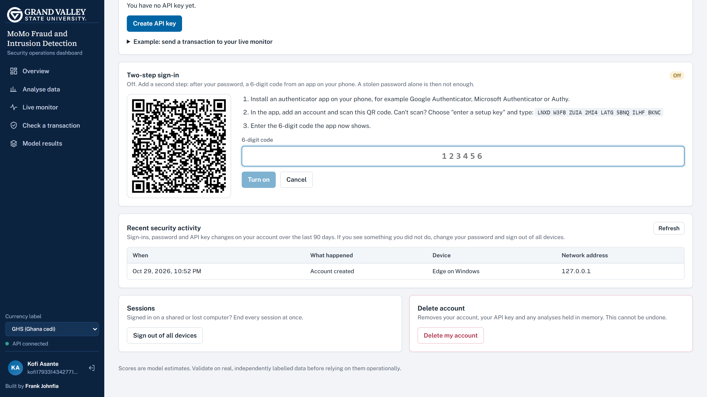

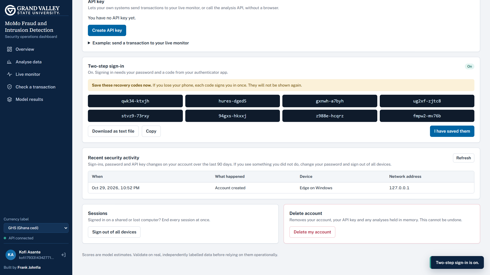

The card then shows how many recovery codes are left. **New recovery codes** replaces them all. **Turn off**
needs your password and a current code (or a recovery code). If your phone's clock is wrong, codes will not
match: set the phone to set its time automatically.

**Check your activity now and then.** If you see a sign-in or change you did not make, change your password
straight away and use **Sign out of all devices**.

## 11. Using the API with your API key

An API key lets your own systems use the platform without a browser. Requests made with your key act as you,
and their results appear only in your account.

1. On the Account page, click **Create API key**.
2. Copy the key (it starts with `momo_`) and store it safely, for example in a password manager.
3. The full key is shown only once. If it leaks, click **Replace key**; the old key stops working at once.

**Send a transaction to your live monitor**

```bash
curl -X POST http://localhost:8000/api/ingest \
  -H "Content-Type: application/json" \
  -H "X-API-Key: YOUR_API_KEY" \
  -d '{"type":"CASH_OUT","amount":250000,"nameOrig":"C1001","nameDest":"C2002","device_id":"dev-77","sim_change":1,"oldbalanceOrg":250000,"newbalanceOrig":0}'
```

The reply lists each transaction's risk score, whether it was flagged and why. Send one transaction or a list
of up to 5,000.

| Method and path | Purpose |
| --- | --- |
| `POST /api/ingest` | Score transactions in real time and push them to your live monitor |
| `POST /api/analyze/upload` | Upload a file for a full analysis (multipart form, field `file`) |
| `POST /api/score` | Score a single transaction described by its model inputs |
| `GET /api/analysis/{id}/export.csv` | Download the flagged transactions of an analysis |
| `GET /api/health` | Check the server is up (no key needed) |

The full interactive list is at `/docs` on your server (unless the owner has turned it off). Never put your
key in a web page, a shared document or a public code repository.

## 12. Reading the results

Every transaction gets a risk score between 0% and 100%, and the score decides which of four responses it
gets. A score is the model's estimate, not proof: confirm with the customer before acting on a high score.

**Response tiers** (default threshold 0.50)

| Score | Tier | Action |
| --- | --- | --- |
| Below 0.30 | Allow | No action needed |
| 0.30 to 0.50 | Allow, but watch | Let through, keep an eye on the account |
| 0.50 to 0.90 | Step-up verification | Ask for a one-time code or biometric check |
| 0.90 and above | Hold | Stop and call the customer |

Moving the threshold moves the verification tier with it; Hold starts at 0.90 or your threshold, whichever is
higher.

**Severity of findings**: *Critical* act today; *High* worth a control change this week; *Medium* watch or
tune; *For information* context; *Good news* something working well.

**Why a transaction was flagged.** In the case panel, a red bar to the right raises the risk and a green bar
to the left lowers it; longer bars matter more. These come from the model's own TreeSHAP values.

**Signal coverage.** How much of the model's signal your data supplied. Device and SIM-change inputs carry
most of it; without them, scores rely on weaker money-only signals. Each input is labelled *provided*,
*derived* (worked out from other columns) or *default* (missing).

**Similarity to the training data (data drift).** A model is reliable on data like what it learned from. For
every input your data supplied, the Data quality tab compares its spread with the training data using the
Population Stability Index (PSI): **under 0.10 similar**, **0.10 to 0.25 somewhat different**, **over 0.25
very different**. The table shows the typical (median) value in training and in your data. When inputs are
very different, a finding appears on the Findings tab: treat scores as indicative and validate them, for
example with a confirmed-fraud column.

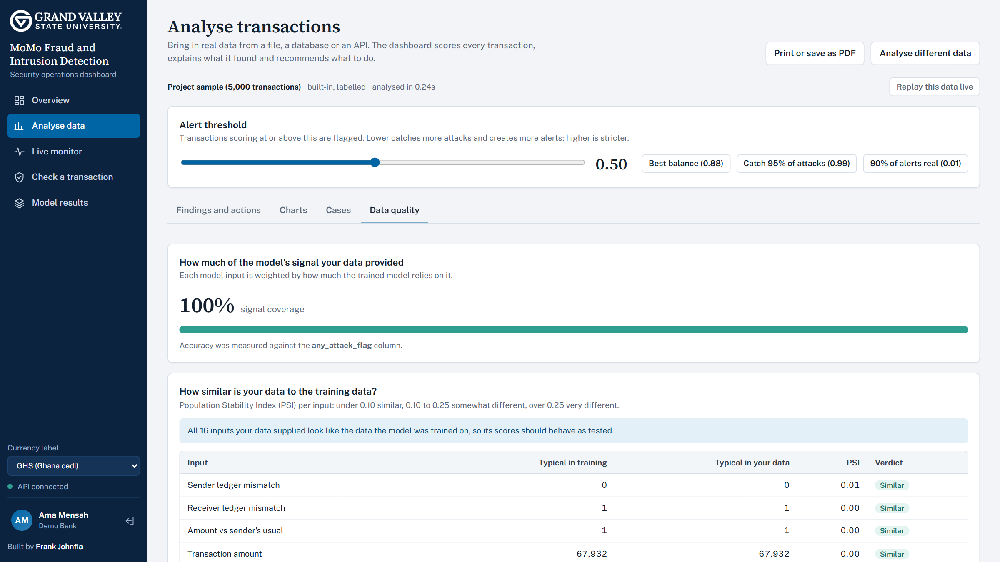

**Accuracy figures.** *Attacks caught* (recall) and *Alerts that are real* (precision) appear only when your
data has a confirmed-fraud column.

## 13. Security and privacy

**How your credentials are stored**

- **Your password is never stored.** Only a one-way salted hash (PBKDF2-SHA256, 600,000 iterations, a unique
  random salt per user) is kept. Nobody, including the server owner, can read your password from it.
- **Your session** is a random token in a cookie that page scripts cannot read; the server stores only a
  hash of it.
- **Your API key** is stored only as a hash and shown to you once.
- **Your recovery codes and password-reset links** are stored only as hashes, and each works once.
- **Your two-step secret** is kept by the server so it can check your codes; it is never shown again or
  sent back by any page.
- **Your uploaded data is never written to disk.** It is analysed in memory and disappears on restart.

**What protects your account**: optional two-step sign-in, single-use 30-minute reset links that never skip
the second step, the password rules in section 3, sign-in pauses after repeated failures,
identical messages for wrong email and wrong password, the security activity log, signing out other devices
when you change your password, and refusing requests that come from other websites.

**What protects everyone's data**: every page and API call requires an account, each user's analyses and
live feed are private, strict browser security headers, limits on upload size and on what the database and
API connectors can reach, safe CSV exports, and a model that loads only if its checksum matches.

Full technical details: [SECURITY.md](../SECURITY.md).

## 14. Running it for others

This section is for whoever hosts the platform for other people.

**Before going public**

1. Host it behind HTTPS, for example with Caddy or Nginx as a reverse proxy.
2. Run it with Docker: `docker compose up --build -d`. The container runs as an unprivileged user on a
   read-only file system, and `docker-compose.yml` already applies the shared-server settings.
3. Once HTTPS works, set `MOMO_SECURE_COOKIES=1` (cookies only over HTTPS, plus HSTS).
4. Set `MOMO_ALLOW_REGISTRATION=0` to close sign-ups once your users have joined, if needed.

**Settings** (environment variables)

| Variable | Default | Shared-server value | What it does |
| --- | --- | --- | --- |
| `MOMO_ALLOW_REGISTRATION` | 1 | 1 or 0 | 0 stops new sign-ups |
| `MOMO_SECURE_COOKIES` | 0 | 1 | Cookies only over HTTPS, and HSTS |
| `MOMO_ALLOW_PRIVATE_HOSTS` | 1 | 0 | Connectors cannot reach internal addresses |
| `MOMO_ALLOW_SERVER_FILES` | 1 | 0 | Visitors cannot read SQLite files on the server |
| `MOMO_API_DOCS` | 1 | 0 or 1 | Hide or show the interactive API docs |
| `MOMO_CORS_ORIGINS` | none | none | Other websites allowed to call the API |
| `MOMO_TRUSTED_ORIGINS` | none | as needed | Other origins allowed to send signed-in requests |
| `MOMO_DB_PATH` | `var/momo.db` | as needed | Where accounts are stored |
| `MOMO_PUBLIC_URL` | none | your site's address | Used to build password-reset links; required with email |
| `MOMO_SMTP_HOST`, `_PORT`, `_USER`, `_PASSWORD`, `_FROM` | none, 587 | your email provider | Sends password-reset emails; without them, links go to the server log |
| `MOMO_MAX_UPLOAD_MB` / `MOMO_MAX_ROWS` | 300 / 1,000,000 | as needed | Upload limits |
| `MOMO_MAX_SESSIONS` | 24 | as needed | Analyses kept in memory (3 per user) |

**Backups.** Accounts live in one SQLite file. Without Docker, copy `var/momo.db` while the server is stopped.
With Docker: `docker compose cp momo-fraud-detection:/app/var/momo.db ./momo-backup.db`. Keep backups private.

**Updating.** `git pull`, then restart (`start.sh`, `start.bat` or `docker compose up --build -d`). Accounts
are kept. Before deploying a change, run the tests: `python -m pytest tests -q --ignore=tests/smoke_test.py`.

## 15. Troubleshooting and FAQ

| Problem | What to do |
| --- | --- |
| Browser says the site can't be reached | The server is not running. Start it and keep that window open. |
| Red dot, "API not reachable" | The server stopped or restarted. Start it again and refresh. |
| "Python 3.12 is needed" on a Mac | `brew install python@3.12`, then `./start.sh` again. |
| "XGBoost could not be loaded" / libomp error on a Mac | `brew install libomp`, then `./start.sh` again. |
| `./start.sh: Permission denied` | Run `chmod +x start.sh` once. |
| Windows: "python is not recognized" | Reinstall Python and tick **Add python.exe to PATH**. |
| Port 8000 already in use | Start on another port, for example `PORT=8080 ./start.sh`. |
| "That password is too common" / "must not contain your name or email" | Choose a different password (section 3). |
| "Too many failed sign-in attempts" | Wait 15 minutes. |
| "That code is not right" at two-step sign-in | Type the code currently shown; check your phone sets its time automatically. |
| Lost the phone with the authenticator app | Use a recovery code, then turn two-step sign-in off and on again with the new phone. |
| Lost the phone and the recovery codes | Ask the person who runs the server. |
| "This reset link is invalid, already used or expired" | Ask for a new link from **Forgot password?**. |
| No reset email arrives | Check spam; on a server without email set up, ask its operator for the link from the server window. |
| "This request came from another website and was blocked" | Open the platform directly from its own address. |
| "The model file failed its integrity check" | `backend/model.joblib` was changed or damaged. Restore it with `git checkout backend/model.joblib`, or retrain. |
| "This analysis has expired from memory" | The server restarted, or you ran more than three analyses. Run it again. |
| "Missing required column(s): amount, type" | Rename or add the columns; `amt`/`value` and `transaction_type` also work. |
| "Your data differs from the data the model learned from" | Scores are less certain. Validate with a fraud column before acting on them. |
| "The file expands to more than ... MB" | Upload the uncompressed file, or split it. |
| "Reading SQLite files on the server is disabled" | Export the table to CSV and upload it instead. |
| Dashboard looks old after an update | Hard-refresh (Ctrl+Shift+R, or Cmd+Shift+R on a Mac). |

**Frequently asked questions**

- **Is there a default login?** No. Everyone creates their own account.
- **My colleague can't sign in with my account.** Accounts live on each server. If you each run it on your
  own computer, each of you signs up there.
- **Can the server owner see my password?** No. Only a one-way hash is stored.
- **Is my data stored?** Uploaded data is analysed in memory only and never written to disk.
- **Can other users see my analyses?** No.
- **I forgot my password.** Click **Forgot password?** on the sign-in page (section 3).
- **Should I turn on two-step sign-in?** Yes, especially if you analyse real customer data.
- **Does the currency selector convert amounts?** No, it only changes the symbol.
- **Can I trust the scores on my own data?** Check the Data quality tab (signal coverage and similarity to the
  training data) and validate with a confirmed-fraud column first.

## 16. Glossary

| Term | Meaning |
| --- | --- |
| Agent collusion | A mobile money agent working with accounts to move fraudulent money, for example many senders paying one receiver |
| Alert threshold | The risk score at or above which a transaction is flagged |
| API key | A secret code that lets your own systems use the platform as you, sent in the `X-API-Key` header |
| AUC-PR | How well the model ranks risky above safe transactions (1.0 is perfect) |
| Data drift | When new data differs from the data a model was trained on, making its scores less reliable |
| F1 | A single score balancing precision and recall |
| Hash | A one-way fingerprint of a secret; the secret cannot be recovered from it |
| Authenticator app | A phone app (Google Authenticator, Microsoft Authenticator, Authy...) that shows a new 6-digit sign-in code every 30 seconds |
| Ingest | Sending transactions to the platform one at a time as they happen |
| Recovery code | A one-time code that replaces the authenticator code if you lose your phone |
| PaySim | A public simulated mobile money dataset (6.36 million transactions) used to train the model |
| PIN-sharing abuse | One account used from several devices, suggesting its PIN is known to others |
| Precision | Of the transactions flagged, the share that were real attacks ("alerts that are real") |
| PSI | Population Stability Index: a measure of how much a value's distribution has shifted |
| Recall | Of the real attacks, the share the model flagged ("attacks caught") |
| Replay | Streaming a saved dataset through the Live monitor to rehearse |
| Risk score | The model's estimate, from 0% to 100%, that a transaction is an attack |
| Salt | Random data added to each password before hashing so identical passwords get different hashes |
| SIM-swap takeover | A criminal moves the victim's number to a new SIM, then drains the account |
| Signal coverage | How much of the model's inputs your data supplied |
| Step-up verification | An extra check before releasing funds, such as a one-time code or biometric |
| TOTP | Time-based one-time password: the standard (RFC 6238) behind authenticator-app codes |
| Two-step sign-in | Signing in with your password plus a code from your phone |
| TreeSHAP | The method used to measure how much each input raised or lowered a single score |
| XGBoost | The gradient-boosted decision-tree model that produces the scores |
